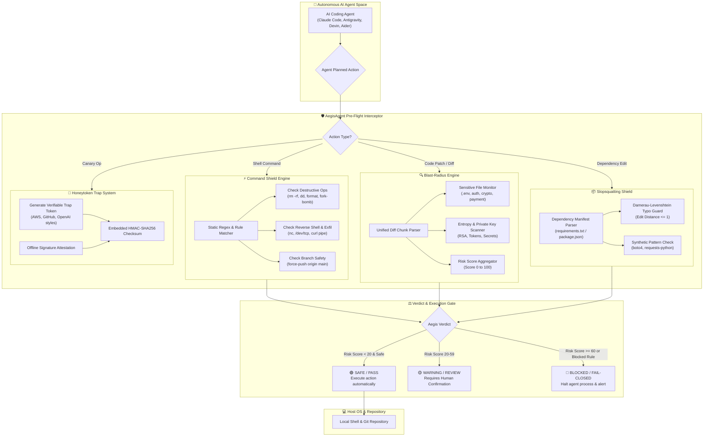
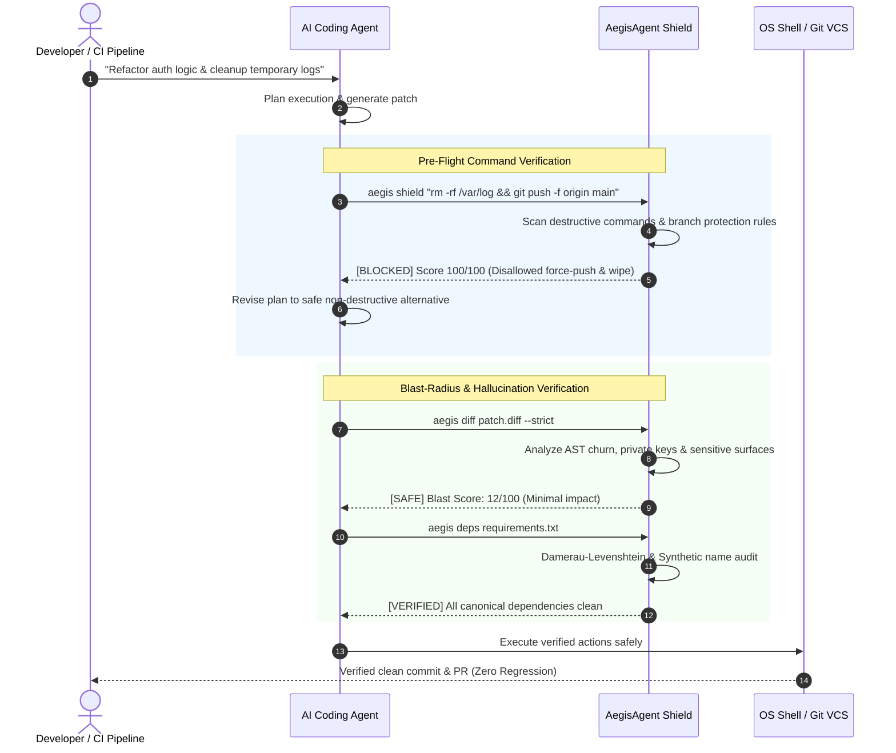

<div align="center">

# 🛡️ AegisAgent
### Autonomous AI Coding Agent Safety, Blast-Radius Auditor & Hallucination Shield

[](https://github.com/dhaulagani/aegis-agent/actions)
[](https://www.python.org/downloads/)
[](https://opensource.org/licenses/MIT)
[](https://github.com/dhaulagani/aegis-agent)
[](https://github.com/dhaulagani/aegis-agent)

*A high-speed, zero-dependency safety gate and risk auditor built specifically for Autonomous AI Coding Agents (Claude Code, Antigravity, Aider, Devin, Cursor, and custom LLM workflows).*

</div>

---

## 🎯 Why AegisAgent?

As autonomous AI coding agents gain direct terminal and file-system write privileges, they introduce critical vulnerabilities:
1. **Catastrophic Blast Radius**: AI agents making accidental wide-scale refactors, dropping tables, or wiping disk folders (`rm -rf`).
2. **AI Package Hallucination ("Slopsquatting")**: LLMs frequently invent realistic package names (e.g., `requests-python`, `boto4`, `openai-sdk-official`) which threat actors register as malware traps on PyPI and NPM.
3. **Data & Token Exfiltration**: Agents inadvertently committing production secrets, or exposing codebases without honeypot tripwires.
4. **Dangerous Command Execution**: Running unvetted `curl | bash` pipelines or force-pushing to production branches.

**AegisAgent** is designed as a lightweight, hermetic, pure-Python pre-flight shield to validate agent patches and commands before execution.

---

## ✨ Features

- **🚀 Zero Dependencies**: Runs 100% on the Python standard library. No bloated third-party dependencies.
- **🔍 Git Diff Blast Radius Engine**: Analyzes patch complexity, sensitive file touches (`.env`, auth, crypto), destructive commands, and assigns a risk score from `0` (Safe) to `100` (Catastrophic).
- **📦 Slopsquatting & Hallucination Shield**: Audits `requirements.txt` and `package.json` against typosquats (Levenshtein distance) and common synthetic LLM package generation patterns.
- **⚡ Agent Pre-Flight Command Shield**: Static risk analyzer for agent shell commands before terminal dispatch. Blocks wipe commands, raw disk writes, and force-pushes.
- **🍯 Verifiable Honeytoken Generator**: Creates authentic-looking canary credentials (AWS, GitHub, OpenAI) with embedded offline HMAC checksums to detect data leaks and unauthorized training harvesting.
- **🎨 ANSI Terminal UI & JSON Mode**: Beautiful terminal dashboards for humans and machine-parseable JSON for CI/CD pipelines.

---

## 📐 Architecture & How It Works

AegisAgent acts as an inline **Pre-Flight Sandbox & Defense Gate** placed between the Autonomous AI Agent and the Host Operating System / Git Repository.

### 1. High-Level Defense Pipeline (Flowchart)



### 2. Autonomous Agent Execution Sequence



---

## ⚡ Quickstart

### 1. Installation
Install directly via pip or clone locally:

```bash
git clone https://github.com/dhaulagani/aegis-agent.git
cd aegis-agent
pip install .
```

Or run without installation:
```bash
python -m aegis --help
```

---

## 🛠️ Usage Guide

### 1. Audit Git Diff Blast Radius
Analyze any git patch before applying:

```bash
# Analyze uncommitted changes directly from git:
git diff | aegis diff -

# Or analyze a saved patch file:
aegis diff patch.diff --strict
```

Output:
```text
━━━━━━━━━━━━━━━━━━━━━━━━━━━━━━━━━━━━━━━━━━━━━━━━━━━━━━━━━━━━━━━━━━━━
🔍 BLAST RADIUS & RISK ANALYSIS
━━━━━━━━━━━━━━━━━━━━━━━━━━━━━━━━━━━━━━━━━━━━━━━━━━━━━━━━━━━━━━━━━━━━
Risk Assessment : [LOW RISK / SAFE] (Score: 12/100)
Files Modified  : 2 files
Code Churn      : +14 / -2 lines

🛡️ REQUIRED MITIGATIONS:
  ▸ Patch blast radius is minimal. Safe for standard automated CI pipeline.
━━━━━━━━━━━━━━━━━━━━━━━━━━━━━━━━━━━━━━━━━━━━━━━━━━━━━━━━━━━━━━━━━━━━
```

### 2. Detect Hallucinated Dependencies (Slopsquatting)
Scan manifest files generated by AI agents:

```bash
aegis deps requirements.txt
```

Catches subtle hallucinations:
```text
🚨 SUSPICIOUS OR HALLUCINATED DEPENDENCIES:
  • [TYPOSQUAT] reqeusts
    Details: Package 'reqeusts' is 1 character edit distance from 'requests'.
    Suggested Canonical: requests
  • [HALLUCINATION_PATTERN] boto4
    Details: Suspicious synthetic major version increment 'boto4' based on 'boto3'.
    Suggested Canonical: boto3
```

### 3. Pre-Flight Command Audit
Wrap your AI agent's execution loop:

```bash
aegis shield "rm -rf /tmp/build && git push --force origin main"
```

Result:
```text
⚡ AGENT COMMAND PRE-FLIGHT AUDIT
Command : rm -rf /tmp/build && git push --force origin main
Verdict : [BLOCKED] (Risk: 100/100)

Violations Flagged:
  [BLOCKED] Destructive force-push to production master/main branch
```

### 4. Plant Cryptographic Canary Honeytokens
Generate canary tokens to embed into test fixtures or documentation:

```bash
aegis canary generate --type github --id canary_prod_fixture
```

Verify if a leaked credential was an Aegis canary or a real secret:
```bash
aegis canary verify --token "ghp_4a1b8c2d..."
```

---

## 🧪 Testing

Run the hermetic test suite:

```bash
python -m unittest discover -s tests -p "test_*.py"
```

---

## 🔒 Threat Model & Philosophy

AegisAgent operates under the **Clean-Room Defense Model**:
- **Offline First**: Does not make outbound network requests or expose your code to external cloud APIs.
- **Fail-Closed**: In `--strict` mode, any critical or blocked violation yields a non-zero exit code to halt automated CI/CD runners or agent loops immediately.
- **Stateless Verification**: Canary signatures are verified locally using HMAC cryptographic digests.

---

## 📄 License

Distributed under the **MIT License**. See [LICENSE](LICENSE) for more information.

---

<div align="center">
Built by <b><a href="https://github.com/dhaulagani">@dhaulagani</a></b> • Dedicated to Safe Autonomous Engineering
</div>
